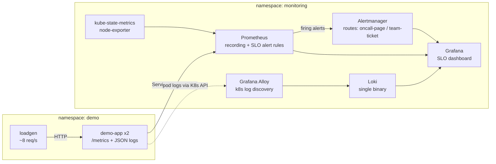

# k8s-observability-stack

[](https://github.com/navi00498/k8s-observability-stack/actions/workflows/ci.yml)


This is a production-style observability stack for Kubernetes that runs on a laptop with **one command**:
metrics, logs, SLO-based alerting, dashboards and runbooks. **CI proves it works**: every push creates a real
cluster, injects failures and checks that the on-call page actually fires.

```bash
make up          # kind cluster + Prometheus/Alertmanager/Grafana + Loki/Alloy + instrumented demo service
make chaos       # 50% of requests start failing
                 # ~10 minutes later DemoAppErrorBudgetBurnFast pages "oncall-page"
make calm        # recover; the alert resolves
```

## What it demonstrates

| Area | Implementation |
|---|---|
| **SLOs and error budgets** | 99.5% availability SLO with **multi-window, multi-burn-rate alerts**, the approach from the Google SRE Workbook: a fast burn (14.4x/6x) pages, a slow burn (3x/1x) opens a ticket |
| **Alerts as code, tested** | `PrometheusRule` CRD plus **promtool unit tests** that feed in synthetic series and assert exactly when each alert fires and when it stays quiet |
| **RED metrics** | Python service instrumented with request rate, errors and duration histograms, and recording rules for p50/p95/p99 |
| **Centralised logs** | Structured JSON logs → **Grafana Alloy** (the successor to Promtail) → **Loki**, with `level` promoted to a label so error logs can be queried |
| **Dashboards as code** | A Grafana dashboard provisioned through a sidecar ConfigMap: SLO stats, burn rates, RED panels, saturation, alert annotations and Loki log panels. CI lints it and type-checks every PromQL query |
| **Alert routing** | Alertmanager routes critical alerts to a paging receiver and warnings to a ticket receiver, and silences Watchdog. Every alert carries a `runbook_url` |
| **Runbooks** | [docs/runbooks.md](docs/runbooks.md): triage steps with ready-to-paste `kubectl`, PromQL and LogQL |
| **Hardened workloads** | Non-root, read-only root filesystem, dropped capabilities, seccomp `RuntimeDefault`, `restricted` Pod Security Standard, resource limits, probes, PodDisruptionBudget |
| **Reproducible** | Helm charts pinned, kustomize overlays, a Makefile for everything. kubeconform validates every manifest, including the rendered Helm output |
| **Chaos in CI** | The GitHub Actions e2e job injects a 30% error rate and asserts the page reaches Alertmanager and the error logs reach Loki, then captures screenshots |

## Architecture



| Component | Chart / version |
|---|---|
| Prometheus, Alertmanager, Grafana, Prometheus Operator, kube-state-metrics, node-exporter | `prometheus-community/kube-prometheus-stack` **92.22.0** |
| Loki (single binary, filesystem storage, TSDB schema v13) | `grafana/loki` **7.5.0** |
| Grafana Alloy (log collector) | `grafana/alloy` **1.15.0** |
| demo-app and loadgen | [`app/`](app/): Python 3.12, `prometheus-client` |

## Quick start

**Prerequisites:** Docker, [kind](https://kind.sigs.k8s.io/), kubectl, Helm 3, and about 4 GB of free RAM.

```bash
git clone https://github.com/navi00498/k8s-observability-stack && cd k8s-observability-stack
make up                     # ~5 minutes on first run (image pulls)
make grafana                # http://localhost:3000  (admin / admin)
```

The **Demo App - SLO and RED overview** dashboard is under *Dashboards*. Other UIs: `make prometheus` (:9090) and
`make alertmanager` (:9093).

Run `make verify` for an end-to-end health check of the whole pipeline:

```text
== Observability pipeline
PASS  Prometheus scrapes both demo-app pods (ServiceMonitor)
PASS  SLO recording rules produce data (PrometheusRule)
PASS  All 4 SLO alert rules are loaded
PASS  No demo-app alerts firing at baseline
PASS  Grafana provisioned the SLO dashboard (sidecar)
PASS  Grafana has Prometheus and Loki datasources
PASS  Loki has demo-app logs (Alloy -> Loki)
All checks passed.
```

`make chaos-test` adds a game day on top: it injects 30% errors and asserts that the error logs reach Loki, that
`DemoAppErrorBudgetBurnFast` fires, and that Alertmanager receives the page. Then it recovers the service.

Run `make down` to delete everything.

## Game day: watch an SLO alert fire

```bash
make chaos      # ERROR_RATE=0.5 on demo-app
```

| Time | What you see |
|---|---|
| ~30s | *Requests by route and status* shows 500s on every route; the *Errors and warnings* Loki panel fills up; *Availability (1h)* starts falling |
| ~1 min | The 5m error ratio is far above the threshold, but nothing pages yet because the 1h window hasn't confirmed it |
| ~9 min | The 1h error ratio passes 7.2% (a **14.4x** burn rate) |
| ~11 min | After `for: 2m`, `DemoAppErrorBudgetBurnFast` fires, Alertmanager routes it to **oncall-page**, and an annotation appears on the dashboard |

The delay is deliberate. A burn-rate alert pages once enough budget is actually at risk, so a smaller incident
(for example 20% errors) takes about 24 minutes to page and a 3-minute blip never does.

```bash
make calm       # back to healthy; the 5m window recovers and the page resolves
make latency    # +600ms: DemoAppHighLatency (p95 > 500ms for 10m) → team-ticket
```

The alert links to its runbook section, for example
[DemoAppErrorBudgetBurnFast](docs/runbooks.md#demoapperrorbudgetburnfast).

## How the SLO alerts work

The SLO is that 99.5% of requests are non-5xx over 30 days, which leaves an error budget of 0.5%. Burn rate is
the observed error ratio divided by 0.5%. A burn rate of 1 uses up exactly the whole budget in 30 days.

```yaml
# Page: losing budget fast. Both the long AND the short window must agree,
# so the alert is not triggered by a blip and resolves quickly after a fix.
- alert: DemoAppErrorBudgetBurnFast
  expr: |
    (  job:slo_errors_per_request:ratio_rate1h{job="demo-app"} > (14.4 * 0.005)
     and job:slo_errors_per_request:ratio_rate5m{job="demo-app"} > (14.4 * 0.005))
    or
    (  job:slo_errors_per_request:ratio_rate6h{job="demo-app"} > (6 * 0.005)
     and job:slo_errors_per_request:ratio_rate30m{job="demo-app"} > (6 * 0.005))
  for: 2m
  labels: {severity: critical}
```

Error ratios for 7 windows (5m to 3d) are precomputed as recording rules, so alert evaluation and dashboard
queries stay cheap. The rules are unit-tested offline. Each scenario feeds synthetic counters to promtool and
asserts the exact alert labels and annotations:

```bash
$ make test-rules
promtool check rules build/demo-app-slo.rules.yaml
  SUCCESS: 15 rules found
promtool test rules tests/rules/demo-app-slo.test.yaml
  SUCCESS
```

| Test scenario | Expected |
|---|---|
| 10% errors for an hour | fast-burn **critical** page and slow-burn ticket, with exact annotations (`10%`) |
| 2% errors | slow-burn **warning** only, no page |
| 3-minute 50% error spike after 7h of healthy traffic | crosses the threshold on the 5m window, but **no page**, because the long windows filter it out |
| Healthy traffic with no 5xx series at all | no alerts, and the error ratio reads `0` instead of "no data" |
| All targets down / no targets discovered | `DemoAppDown` fires (via `up == 0` and `absent()`) |
| One of two replicas down | no `DemoAppDown`; it's not an outage |
| p95 ~ 964ms for 10 minutes | `DemoAppHighLatency` warning |

If you replace the fast-burn rule with a naive `5m error ratio > threshold` alert, the spike test fails, so the
suite really does guard the design.

## Repository layout

```text
app/                         demo-app (instrumented HTTP API), loadgen, unit tests, Dockerfile
helm/                        values for kube-prometheus-stack, Loki and Alloy (Alloy pipeline config inline)
k8s/demo-app/                Namespace (restricted PSS), Deployment, Service, PDB, ServiceMonitor, loadgen
k8s/monitoring/              PrometheusRule (recording + SLO alerts), Grafana dashboard JSON
tests/rules/                 promtool unit tests for every alert
scripts/verify.sh            end-to-end checks (+ chaos mode) used locally and in CI
scripts/lint_dashboards.py   dashboard lint + PromQL extraction for promtool
docs/runbooks.md             on-call runbooks linked from every alert
kind/cluster.yaml            local cluster definition
```

## CI

| Job | What it checks |
|---|---|
| **Lint and unit tests** | demo-app unit tests · promtool rule check plus SLO unit tests · kubeconform on kustomize output **and** on fully rendered Helm charts · dashboard lint plus a PromQL type-check for every panel · `alloy fmt` on the log pipeline |
| **End-to-end on kind** | Creates a cluster, installs the pinned stack, deploys the app, runs `verify.sh`, then **injects 30% errors** and asserts that the fast-burn alert reaches Alertmanager and the error logs are in Loki. Uploads Grafana and Alertmanager screenshots as artifacts |

## Design decisions

- **Multi-window burn-rate alerts instead of `error_rate > X`.** Threshold alerts are either noisy or slow.
  Burn-rate alerts page in proportion to how much of the budget is at risk, so a 3-minute blip doesn't wake
  anyone, and the test suite proves it.
- **Alloy instead of Promtail.** Promtail is deprecated in favour of Alloy. Alloy reads pod logs through the
  Kubernetes API, so it needs no hostPath mounts and runs as a single Deployment, which suits kind and
  restricted environments.
- **Loki single-binary on the filesystem.** It's the right size for a lab. The production path is the
  `SimpleScalable` mode backed by object storage (S3/GCS), which is listed in the roadmap.
- **Everything is in the git repo and pinned.** Chart versions, dashboards, rules and runbooks live together,
  so a change to an alert gets reviewed like code and tested in CI before it can page anyone.
- **The demo service is deliberately simple.** It uses only the standard library and `prometheus-client`, with
  fault-injection knobs (`ERROR_RATE` and `EXTRA_LATENCY_MS`) so failures are reproducible on demand.

## Roadmap

- [ ] Distributed tracing with OpenTelemetry → Tempo, with exemplars linking metrics to traces
- [ ] Terraform module for an EKS deployment, with Loki on S3 and IRSA
- [ ] Real receivers: Slack and PagerDuty via an Alertmanager config secret
- [ ] Generate SLO rules from a spec (Sloth/OpenSLO) instead of hand-written YAML
- [ ] Synthetic probing with blackbox-exporter

## Disclaimer

This is a personal learning and portfolio project. It is not affiliated with or endorsed by any employer, and it
uses only public open-source software and synthetic traffic.

## License

[MIT](LICENSE)
